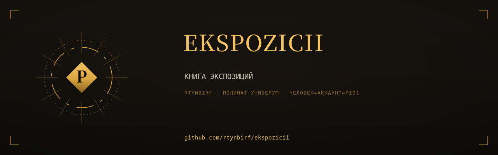

# КНИГА ЭКСПОЗИЦИЙ

  

> Собрана 2026-11-11 из 6 репозиториев аккаунта rtynbirf. Каждая глава — снимок `main` оригинала на дату сборки (см. `PROVENANCE.md` внутри главы). Оригиналы архивированы read-only, история коммитов сохранена там.

**Книга несёт только чистовое: черновики и предыдущие редакции снесены из книги (по слову Хозяина 2026-11-11) и живут в архивных оригиналах.**

## Оглавление

| Глава | Источник | Файлов | Коммитов в ориг. | Снимок |
|---|---|---|---|---|
| [yazyk-skvoz-epohi](glavy/yazyk-skvoz-epohi/) | [оригинал](https://github.com/rtynbirf/yazyk-skvoz-epohi) | 38 | 41 | `a58a4a6` |
| [web-evolution-1991-2026](glavy/web-evolution-1991-2026/) | [оригинал](https://github.com/rtynbirf/web-evolution-1991-2026) | 38 | 24 | `f94a654` |
| [windows-chronicle](glavy/windows-chronicle/) | [оригинал](https://github.com/rtynbirf/windows-chronicle) | 89 | 52 | `c3dedc4` |
| [linguistic-code](glavy/linguistic-code/) | [оригинал](https://github.com/rtynbirf/linguistic-code) | 14 | 4 | `2905744` |
| [polymath-tools-atlas](glavy/polymath-tools-atlas/) | [оригинал](https://github.com/rtynbirf/polymath-tools-atlas) | 55 | 42 | `b594a29` |
| [global-video-platforms-registry](glavy/global-video-platforms-registry/) | [оригинал](https://github.com/rtynbirf/global-video-platforms-registry) | 64 | 44 | `5fdffdb` |

## О чём эта книга

Книга: 7 автономных HTML-экспозиций одним томом — Эволюция Веба, Хроника Windows, Язык сквозь эпохи (2 редакции), философия языка, TOOLS-ATLAS, реестр видеоплатформ. Собрано из 7 репозиториев rtynbirf.

## Как читать

Каждый каталог в `glavy/` — самостоятельная глава со своим README (если оно было в оригинале). Имена глав совпадают с именами исходных репозиториев.

## Канон

**Канон темы «Язык сквозь эпохи»** — глава `yazyk-skvoz-epohi` (редакция v21). Предыдущая редакция (`language-through-the-ages`) снесена из книги по слову Хозяина «оставить чистовое, без черновиков» и живёт в архивном оригинале: https://github.com/rtynbirf/language-through-the-ages
