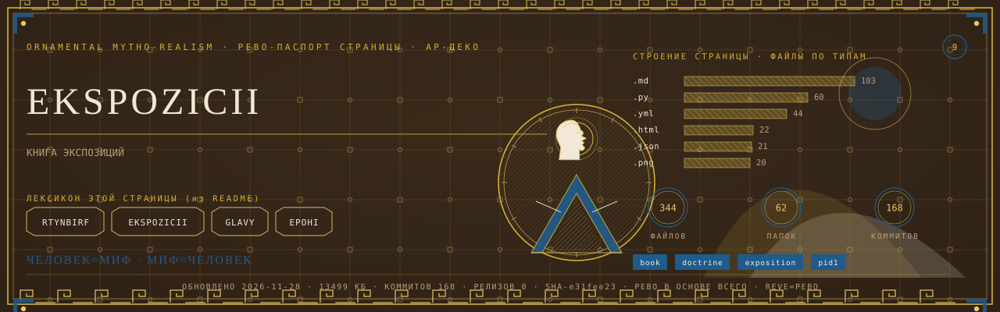
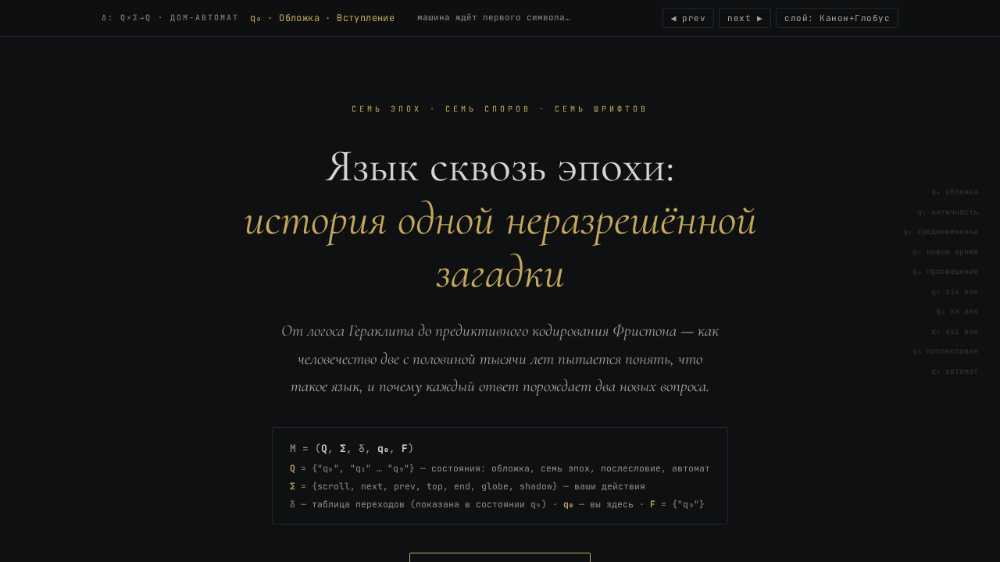
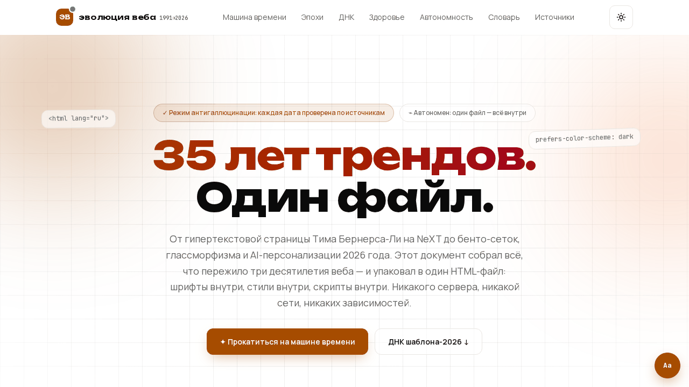
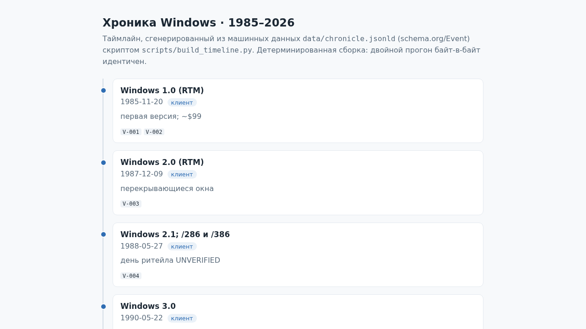
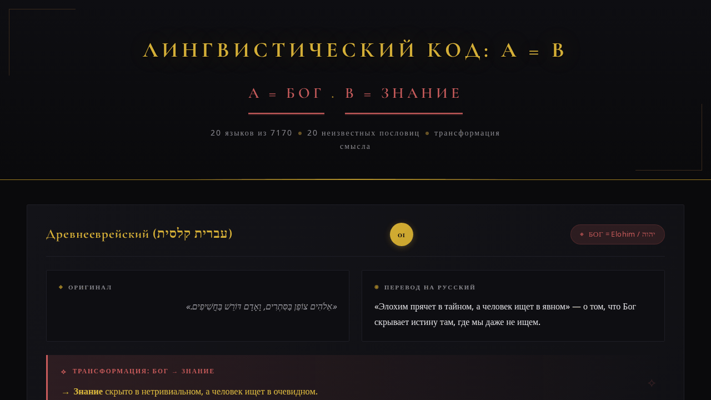
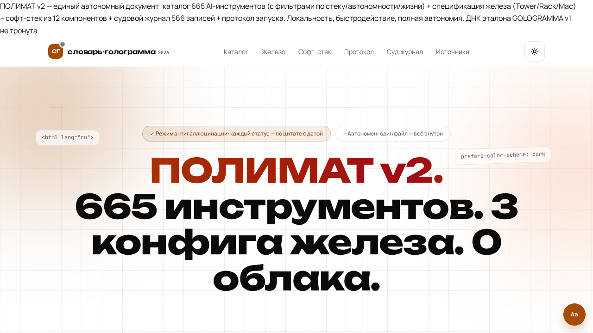

# КНИГА ЭКСПОЗИЦИЙ

  

<!--ФОРЖ:МУЗА:НАЧАЛО-->

  
   
  

<!--ФОРЖ:МУЗА:КОНЕЦ-->

<!--ФОРЖ:ПАСПОРТ:НАЧАЛО-->

  

| ФАЙЛОВ | ПАПОК | КОММИТОВ | ОБНОВЛЕНО | РЕЛИЗОВ |
|---:|---:|---:|---|---:|
| 335 | 61 | 97 | 2026-11-19 | 0 |
<!--ФОРЖ:ПАСПОРТ:КОНЕЦ-->

> Собрана 2026-11-11 из 6 репозиториев аккаунта rtynbirf. Каждая глава — снимок `main` оригинала на дату сборки (см. `PROVENANCE.md` внутри главы). Оригиналы архивированы read-only, история коммитов сохранена там.

**Книга несёт только чистовое: черновики и предыдущие редакции снесены из книги (по слову Хозяина 2026-11-11) и живут в архивных оригиналах.**

## Оглавление

| Глава | Источник | Файлов | Коммитов в ориг. | Снимок |
|---|---|---|---|---|
| [yazyk-skvoz-epohi](glavy/yazyk-skvoz-epohi/) | [оригинал](https://github.com/rtynbirf/yazyk-skvoz-epohi) | 38 | 41 | `a58a4a6` |
| [web-evolution-1991-2026](glavy/web-evolution-1991-2026/) | [оригинал](https://github.com/rtynbirf/web-evolution-1991-2026) | 38 | 24 | `f94a654` |
| [windows-chronicle](glavy/windows-chronicle/) | [оригинал](https://github.com/rtynbirf/windows-chronicle) | 89 | 52 | `c3dedc4` |
| [linguistic-code](glavy/linguistic-code/) | [оригинал](https://github.com/rtynbirf/linguistic-code) | 14 | 4 | `2905744` |
| [polymath-tools-atlas](glavy/polymath-tools-atlas/) | [оригинал](https://github.com/rtynbirf/polymath-tools-atlas) | 55 | 42 | `b594a29` |
| [global-video-platforms-registry](glavy/global-video-platforms-registry/) | [оригинал](https://github.com/rtynbirf/global-video-platforms-registry) | 64 | 44 | `5fdffdb` |

## О чём эта книга

Книга: 7 автономных HTML-экспозиций одним томом — Эволюция Веба, Хроника Windows, Язык сквозь эпохи (2 редакции), философия языка, TOOLS-ATLAS, реестр видеоплатформ. Собрано из 7 репозиториев rtynbirf.

## Как читать

Каждый каталог в `glavy/` — самостоятельная глава со своим README (если оно было в оригинале). Имена глав совпадают с именами исходных репозиториев.

## Канон

**Канон темы «Язык сквозь эпохи»** — глава `yazyk-skvoz-epohi` (редакция v21). Предыдущая редакция (`language-through-the-ages`) снесена из книги по слову Хозяина «оставить чистовое, без черновиков» и живёт в архивном оригинале: https://github.com/rtynbirf/language-through-the-ages

## Как читать книгу

- Каждая глава (`glavy/<глава>/`) — снимок `main` оригинала на дату сборки; происхождение и SHA снимка — в `PROVENANCE.md` внутри главы.
- Правки — только в оригиналах (ссылки в оглавлении выше); оригиналы архивированы read-only, история коммитов сохранена в них.
- Ядро дома — [polymath-core](https://github.com/rtynbirf/polymath-core); живой реестр аккаунта — [index](https://github.com/rtynbirf/index).
- Онлайн-версия тома: https://rtynbirf.github.io/ekspozicii/
- Лицензия тома — MIT ([LICENSE](LICENSE)); у каждой главы — лицензия её оригинала.

## Лица глав

### [yazyk-skvoz-epohi](glavy/yazyk-skvoz-epohi/)

Язык сквозь эпохи · Дом-Автомат v21 — семиэпохальное эссе.

Онлайн-версия оригинала: https://rtynbirf.github.io/yazyk-skvoz-epohi/

### [web-evolution-1991-2026](glavy/web-evolution-1991-2026/)

Эволюция Веба 1991→2026 — 5 эпох, таймлайн.

### [windows-chronicle](glavy/windows-chronicle/)

Полная хроника Microsoft Windows 1985–2026.

### [linguistic-code](glavy/linguistic-code/)

Философский артефакт о языке, теле и опыте.

### [polymath-tools-atlas](glavy/polymath-tools-atlas/)

Атлас инструментов ПОЛИМАТ — финальная витрина.

### [global-video-platforms-registry](glavy/global-video-platforms-registry/)

Верифицированный реестр 1071 видеоплатформы (1032 активных) — окт 2026. CSV/JSON/XLSX/PDF + методология + evidence. Витрина и онлайн-версия у этой главы не строились — глава живёт в книге и в архивном оригинале.

<!--ФОРЖ:ПОДВАЛ-->
---

  ◆ картина и штандарт — ручная ковка <a href="https://github.com/rtynbirf">КУЗНИ ПОЛИМАТ</a> · ЧЕЛОВЕК=АККАУНТ=PID1 ◆

